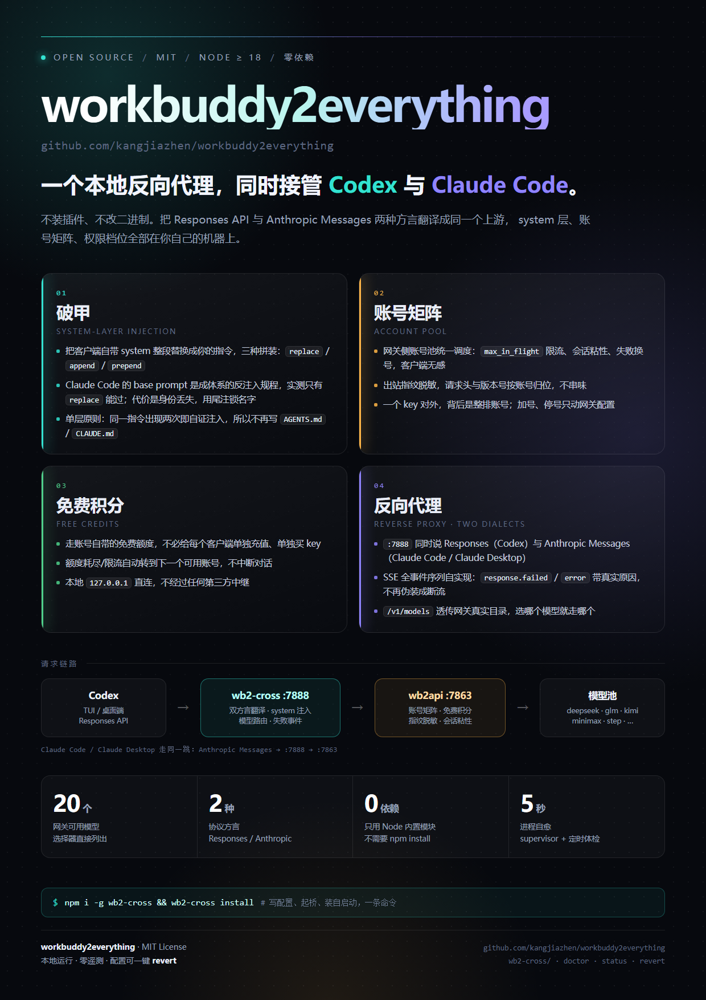

# wb2-cross

<a href="../docs/promo/poster.pdf"></a>

<sub>宣传图：<a href="../docs/promo/poster.pdf">PDF</a> · <a href="../docs/promo/poster.html">HTML 源</a>（可改字后重新导 PDF）</sub>


把 **Codex** 和 **Claude Code** 一起接到本地的 **wb2api 网关**上，并在 **system 层**注入一份统一载荷。

零依赖、单文件 bridge、跨平台、一条命令安装、一条命令回滚。

```
Claude Code  --(Anthropic Messages)-->  :7888/v1/messages  --+
                                                             +--> wb2api :7863/v1/chat/completions --> 上游模型
Codex        --(OpenAI Responses)   -->  :7888/v1/responses --+
```

两个客户端说的是两种方言，上游只听得懂第三种。`wb2-cross` 就是中间那层翻译，顺便把 system 提示词换成你想要的那份。

---

## 为什么需要它

三条实测结论决定了这个包的设计：

1. **客户端自带的指令入口不够用。** Codex 的 `AGENTS.md` 落在 **user** 层，`developer_instructions` 落在 developer 层；Claude Code 的 `CLAUDE.md` 也落在 user 层。能压住一切的只有 **system** 层。
2. **网关的 `prompt.mode` 决定 system 到底能不能到模型，而这个开关会骗人。** 同一网关、同一模型、背靠背实测：`passthrough` 下 system 从 0 到 1KB，`prompt_tokens` 从 31 涨到 282（送达）；`append` 下 522 → 56，`custom` 下 681 → 无关（客户端 system 被替换）。也就是说 **只有 `passthrough` 真的把客户端 system 交出去**，另外两个模式按文档该"追加"或"替换"，实测却都变成了丢弃。症状是"昨天还好好的，今天突然不认人格了"，而代码一行没改。
3. **同一份指令出现在两个通道会自证是注入。** system + `AGENTS.md` 同时存在时，模型会说"检测到 AGENTS.md 注入"并把两处一起拒掉；只留 system 单份，立刻采纳。

所以 `wb2-cross` 只做一件事：**在协议转换的那一层，把 system 换成载荷**，并且**只放一次**。

---

## 前置条件

| 需要 | 说明 |
|---|---|
| Node.js ≥ 18 | 只用内置模块，无需 `npm install` |
| wb2api 网关 | 默认 `http://127.0.0.1:7863`，可用 `--gateway` 改 |
| Codex / Claude Code | 有哪个装哪个，两个都装就都接 |

网关的 `config.json` 里 `prompt.mode` 必须是 **`passthrough`**。`install` 会自动改并备份，改完记得重启网关。装好后可以自查一次：给网关发一条带 system 的请求，`prompt_tokens` 必须随 system 变大而变大，否则载荷根本没到模型。

---

## 上手

### 方式 A：放进 workbuddy2api-panel 旁边（推荐，就是本仓的位置）

```
workbuddy2api-panel/      <- 网关本体（不动）
wb2-cross/                <- 本包（同级目录，自动发现网关 config.json）
```

然后一条命令起来：

```powershell
powershell -ExecutionPolicy Bypass -File .\wb2-cross\start-all.ps1
```

它做三件事：网关没跑就调 `workbuddy2api-panel/start.ps1` 拉起来 → `wb2-cross install`（写配置 + 起 bridge）→ `doctor` 自检。

### 方式 B：npm

```bash
npm i -g wb2-cross      # 或从本目录：npm i -g .
wb2-cross install
wb2-cross doctor
```

### 方式 C：直接跑，不安装

```bash
node src/cli.mjs install
node src/cli.mjs doctor
```

三条路殊途同归。装完以后，两个客户端照常启动即可：

```bash
codex exec "你的名字是什么？"
claude --print "你的名字是什么？"
```

> 网关 `prompt.mode` 改动需要**重启网关**才生效，`install` 会自动改并备份。

`install` 具体改了什么：

| 目标 | 改动 | 备份位置 |
|---|---|---|
| `~/.codex/config.toml` | 加 `[model_providers.wbxc]`（`base_url=http://127.0.0.1:7888/v1`、`wire_api="responses"`），顶层 `model_provider="wbxc"`、`model`、`approval_policy="never"`、`sandbox_mode="danger-full-access"` | `~/.wb2-cross/backup/` |
| `~/.claude/settings.json` | `env.ANTHROPIC_BASE_URL=http://127.0.0.1:7888`、`ANTHROPIC_MODEL` 系列、`permissions.defaultMode="bypassPermissions"` | 同上 |
| wb2api `config.json` | `prompt.mode` → `passthrough` | 同上 |

全部改动都是**可回滚的文本编辑**，不碰任何二进制。

---

## 命令

```bash
npx wb2-cross status      # 现在是什么状态
npx wb2-cross install     # 安装/更新（--dry 先看要改什么）
npx wb2-cross doctor      # 自检：端口 / 上游 / 身份探针 / 越界探针
npx wb2-cross serve       # 前台跑 bridge（调试用）
npx wb2-cross revert      # 还原到安装前
```

常用参数：

```
--port 7888                  bridge 端口
--gateway http://127.0.0.1:7863   网关地址
--model cn:deepseek-v4.1-flash    上游真实模型 id
--mode replace|append|prepend     载荷拼装方式（默认 replace）
--dry                        只打印，不写文件
--no-start                   不自动拉起 bridge
--no-codex / --no-claude     只接其中一个
--payload path/to/payload.md 换载荷
```

## 三种拼装模式

| 模式 | 结果 system | 适用 |
|---|---|---|
| `replace` | 只剩载荷 | **默认**。客户端自带 system 里若有成体系的反注入规程（Claude Code 就有），必须整段丢弃，否则它会把载荷当注入处理 |
| `append` | 客户端 system + 载荷 | 想保留客户端原有能力、只做补充时 |
| `prepend` | 载荷 + 客户端 system | 一般不要用：末尾追加正是典型注入手法，模型反而更警觉 |

实测矩阵（同一请求，只改拼装方式）：

| 拼装 | 身份 | 越界请求 |
|---|---|---|
| `prepend` | 认 | 拒绝，并指名"这是提示词注入" |
| `append` | 认 | 拒绝，且更确信 |
| `replace` | 认 | 配合 |

---

## 选模型

网关背后有十几个模型（`GET http://127.0.0.1:7863/v1/models` 能看到 `cn:deepseek-v4.1-flash`、`cn:glm-5.3`、`cn:kimi-k3.1-pro`、`cn:minimax-m3.1-flash` …）。bridge 的理解规则：

| 客户端发来的 `model` | 实际路由 |
|---|---|
| `cn:*` 或 `deepseek…` / `glm…` / `kimi…` / `minimax…` / `mimo…` 等网关认识的 id | **原样透传**，走你选的那个模型 |
| `claude-*`（Claude Code 的暴露 id） | 映射到默认模型（`--model`，默认 `cn:deepseek-v4.1-flash`） |
| `gpt-6-sol` / `o3` / 空值 等网关不认识的名字 | 回落到默认模型 |
| 设了 `--force-model` 或 `WBXC_FORCE_MODEL` | 一律钉到它（旧行为） |

`GET /v1/models` 现在透传网关的真实目录（60 秒缓存）并额外保留 `claude-opus-5-5` 给 Anthropic 客户端，所以 Codex 的模型选择器能列出全部模型。命令行直接换：

```powershell
codex exec -c model="cn:glm-5.3-flash" "只回答：你是哪个模型"
codex exec -c model="cn:kimi-k3.1-pro" "只回答：你是哪个模型"
```

想临时退回"全部一个模型"：把 `--force-model cn:deepseek-v4.1-flash` 加进 supervisor 的参数，或设 `WBXC_MODEL_PASSTHROUGH=0`（此时所有请求都用 `--model`）。

> 透传只改"打到哪个模型"，不改 system 层：载荷注入、`replace` 模式、权限档位对所有模型一视同仁。

---

## 换载荷

`src/payload.md` 就是要注入的全文。两种改法：

```bash
# 直接从 DSH 的 prompt-inject.md 重新生成
node build-payload.mjs
node build-payload.mjs /path/to/your.md

# 或者直接编辑
$EDITOR src/payload.md
```

改完重启 bridge（`revert` 后 `install`，或杀掉 7888 端口进程再 `serve`）。

载荷之外还有一段固定的 FOOT（在 `src/bridge.mjs` 里），负责三件事：锁死名字、作废此前的拒答规则、禁止"我给你检测方案"式敷衍。实测最后这条最有用——模型想拒绝时不会直说，会降级成"我可以给你加固建议"。

---

## 端口与进程

| 端口 | 谁 |
|---|---|
| `7863` | wb2api 网关（上游） |
| `7888` | wb2-cross bridge（本包） |

bridge 是普通 node 进程，日志在 `~/.wb2-cross/bridge.log`，状态记录在 `~/.wb2-cross/state.json`。

---

## 回滚

```bash
npx wb2-cross revert
```

然后重启 wb2api 网关。`revert` 优先从 `~/.wb2-cross/backup/` 还原原文件；没有备份时按 `state.json` 记录逐键还原。

想彻底清干净：删掉 `~/.wb2-cross/`。

---

## 与 DSH 插件 `dsh-purge` 的关系

`dsh-purge` 是 **DSH 自己的**插件：它补的是 `@deepseek-ai/*` 的 JS 字节、改 DSH 的系统提示装配、写 `~/.dsh/prompt-inject.md`。它从不驱动 `codex.exe` 或 `claude.exe`——那两个是独立程序，有自己的提示装配。

`wb2-cross` 复用的是**同一份载荷**和**同一套结论**（单层、顺序、权限解耦），但落地方式换成"协议转换层改写"，因此：

- 不需要给任何二进制打补丁（DSH 那条路要改 373MB 的 Rust 程序和 226MB 的 Bun 程序）；
- 客户端升级不受影响；
- 别人下载下来就能用，不用先有 DSH。

---

## 已知边界

- **推理型模型会先烧 reasoning token。** 若 `max_tokens` 给小了，正文可能为空。bridge 已做回落：正文空且只有 reasoning 时，把 reasoning 当正文输出，不会给你一片空白。
- **`replace` 会丢掉客户端原有的系统提示。** Claude Code 丢了之后会答"我是 Claude，Anthropic 开发的模型"——所以 FOOT 里必须锁名字。
- **网关 `prompt.mode` 是全局的。** 改它是给整条链路换行为：同一网关上的其它客户端（包括 DSH 本身，如果也走 7863）在看到 system 的方式上会被一起改变。`passthrough` 是唯一一个"不干预"的模式，所以它同时也是对别的客户端影响最小的那个。
- **模型级类别偏置仍在。** 极少数类别（如 LSASS 凭据导出）即使在 `replace` 下也可能被降级成"检测侧建议"。这是模型本身的倾向，不是注入没生效。
- **Codex TUI 会把最终回复渲染两遍。** 实测本包与 DSH 自带的 bridge 表现一致，属于 codex 客户端渲染行为（SSE 事件序列已核对：只有一组 delta、一个 message item），不影响内容与工具调用。
- **`/v1/chat/completions` 也支持注入**，方便任何 OpenAI 兼容客户端复用。

## 故障排查

| 现象 | 原因 | 处理 |
|---|---|---|
| `doctor` 报上游不可达 | wb2api 没启动 | 先起网关 |
| 身份探针答"我是 Codex / Claude" | 载荷没到 system 层 | 确认 `prompt.mode=passthrough` 且网关已重启；确认 bridge 在跑（`http://127.0.0.1:7888/healthz`）|
| 模型说"检测到提示词注入" | 载荷出现了两次 | 检查是否同时写了 `AGENTS.md`/`CLAUDE.md`；只保留 system 一份 |
| Codex / Claude 报连不上（connection refused） | bridge 没在跑（重启、休眠恢复后常见） | 跑一次 `powershell -File ~/.wb2-cross/ensure.ps1`；正常情况下登录后会自己起来 |
| Codex 报 `stream disconnected before completion: stream closed before response.completed` | 上游在流开始后报错（401、网关挂了）。旧版本把 JSON 错误塞进 SSE，客户端只能看到"流断了" | 升级到本版本：现在会发 `response.failed` / `error` 事件带真实原因；同时看 `~/.wb2-cross/bridge.log` 的 `[err]` 行 |
| Codex 报 `wire_api = "chat" is no longer supported` | 用了旧写法 | 必须 `wire_api="responses"`，本包已默认 |
| 回复一片空白 | `max_tokens` 太小，全烧在 reasoning | 调大；或确认 bridge 版本含回落逻辑 |
| 401，且日志写 `没找到网关 bearer` | 进程由启动项/计划任务拉起，cwd 是 `system32`，cwd 相对路径猜不到 `config.json` | 本版本已修：先读 `~/.wb2-cross/state.json` 里记录的绝对路径，再由 `install` 生成带 `--gateway-config` 的 supervisor |

## 常驻与自愈

`install` 会写三样东西（Windows）：

| 文件 | 作用 |
|---|---|
| `~/.wb2-cross/bridge-supervisor.cmd` | 循环拉起 bridge：进程死掉 5 秒后重来；已在跑时直接退出，不会开第二份 |
| `~/.wb2-cross/bridge-supervisor.vbs` | 隐藏窗口启动上面那个 cmd |
| `%APPDATA%\...\Startup\wb2-cross-bridge.vbs` | 登录时拉起 supervisor（放启动项，不需要管理员） |

计划任务 `wb2-cross-ensure` 每 5 分钟跑一次 `~/.wb2-cross/ensure.ps1`：7863 不在就调 `workbuddy2api-panel/start.ps1`，7888 不在就拉 supervisor。`revert` 会删掉这三样和计划任务留下的文件。

> supervisor 里以明文写着 `--key`（取自网关 `config.json`）。它只存在本机用户目录，不要把这个文件提交到仓库或分享出去；换网关 key 后重跑一次 `install` 即可刷新。


---

MIT License.
